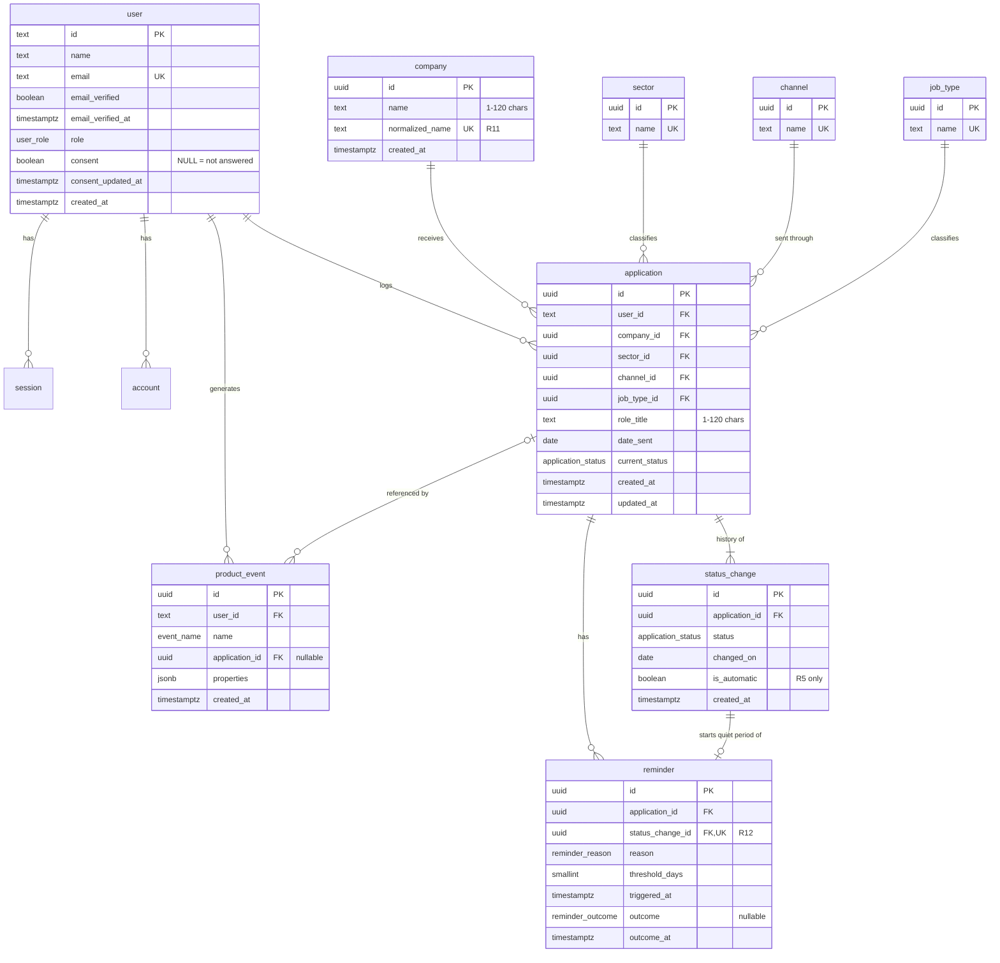

# Trilho — Data model

_Source: `db/schema.ts` · first migration `db/migrations/0000_*.sql` · Postgres (Neon)_

Column names are `snake_case` in Postgres (camelCase in TypeScript). Our tables use UUID primary keys (`gen_random_uuid()`); the Better Auth tables keep Better Auth's `text` ids, and every FK to `user.id` is `text`. Timestamps are `timestamp with time zone`; `date_sent` and `changed_on` are `date`.

## ER diagram

`session`, `account` and `verification` are Better Auth's tables (sessions, password credentials, email verification tokens).

## Enums

| Enum | Values |
|---|---|
| `user_role` | `student`, `career_service` |
| `application_status` | `sent`, `in_process`, `interview`, `offer`, `rejected`, `no_response` |
| `reminder_reason` | `company_median`, `fallback_14_days` |
| `reminder_outcome` | `followup_done`, `dismissed` |
| `event_name` | `application_form_opened`, `application_created`, `reminder_triggered`, `reminder_followup_done`, `reminder_dismissed` |

## Tables

### `user` (Better Auth + Trilho fields)

| Column | Type | Null | Default | Notes |
|---|---|---|---|---|
| `id` | text | no | — | **PK** (generated by Better Auth) |
| `name` | text | no | — | |
| `email` | text | no | — | **UNIQUE** |
| `email_verified` | boolean | no | `false` | Set by Better Auth |
| `image` | text | yes | — | Unused |
| `created_at` | timestamptz | no | `now()` | Registration date (M3 per week, M6, M7) |
| `updated_at` | timestamptz | no | `now()` | |
| `role` | `user_role` | no | `'student'` | Not settable at sign-up (`input: false`) |
| `consent` | boolean | yes | — | `NULL` = not answered yet (US01-4) |
| `consent_updated_at` | timestamptz | yes | — | Date of the last consent choice |
| `email_verified_at` | timestamptz | yes | — | Needed for M6; Better Auth only stores a boolean |

**Why `role` is a Postgres enum:** Better Auth's Drizzle adapter reads and writes it as a plain string, which Postgres accepts for enum columns. An enum gives the same database guarantee as a CHECK and matches the other enums. In `lib/auth.ts` it is declared with `type: ["student", "career_service"]`, so its TypeScript type is the union.

### `session`, `account`, `verification` (Better Auth)

| Table | PK | FKs | Constraints / indexes |
|---|---|---|---|
| `session` | `id` text | `user_id` → `user.id` **ON DELETE CASCADE** | `token` UNIQUE; index `session_user_id_idx` |
| `account` | `id` text | `user_id` → `user.id` **ON DELETE CASCADE** | index `account_user_id_idx`; `password` holds the hash |
| `verification` | `id` text | — | index `verification_identifier_idx` |

### `company`

| Column | Type | Null | Default | Notes |
|---|---|---|---|---|
| `id` | uuid | no | `gen_random_uuid()` | **PK** |
| `name` | text | no | — | Display name: first version typed, trimmed (R11). **CHECK** `char_length BETWEEN 1 AND 120` |
| `normalized_name` | text | no | — | R11 key. **UNIQUE** (`company_normalized_name_unique`) |
| `created_at` | timestamptz | no | `now()` | |

### `sector`, `channel`, `job_type` (fixed lists, SPEC §5)

| Column | Type | Null | Default | Notes |
|---|---|---|---|---|
| `id` | uuid | no | `gen_random_uuid()` | **PK** |
| `name` | text | no | — | **UNIQUE** |

Loaded by the seed; not editable in the MVP.

### `application`

| Column | Type | Null | Default | Notes |
|---|---|---|---|---|
| `id` | uuid | no | `gen_random_uuid()` | **PK** |
| `user_id` | text | no | — | FK → `user.id` **ON DELETE CASCADE** |
| `company_id` | uuid | no | — | FK → `company.id` **ON DELETE RESTRICT** |
| `sector_id` | uuid | no | — | FK → `sector.id` **ON DELETE RESTRICT** |
| `channel_id` | uuid | no | — | FK → `channel.id` **ON DELETE RESTRICT** |
| `job_type_id` | uuid | no | — | FK → `job_type.id` **ON DELETE RESTRICT** |
| `role_title` | text | no | — | **CHECK** `char_length BETWEEN 1 AND 120` |
| `date_sent` | date | no | — | "Not in the future" is validated in Zod (depends on today) |
| `current_status` | `application_status` | no | `'sent'` | Duplicates the last `status_change` on purpose (fast pipeline) |
| `created_at` | timestamptz | no | `now()` | |
| `updated_at` | timestamptz | no | `now()` | Updated by Drizzle on update |

Indexes: `application_user_id_idx` (`user_id`), `application_company_id_idx` (`company_id`).

### `status_change`

| Column | Type | Null | Default | Notes |
|---|---|---|---|---|
| `id` | uuid | no | `gen_random_uuid()` | **PK** |
| `application_id` | uuid | no | — | FK → `application.id` **ON DELETE CASCADE** |
| `status` | `application_status` | no | — | |
| `changed_on` | date | no | — | |
| `is_automatic` | boolean | no | `false` | `true` only for the 60-day rule (R5) |
| `created_at` | timestamptz | no | `now()` | When it was recorded |

Index: `status_change_application_changed_on_idx` (`application_id`, `changed_on`).

### `reminder`

| Column | Type | Null | Default | Notes |
|---|---|---|---|---|
| `id` | uuid | no | `gen_random_uuid()` | **PK** |
| `application_id` | uuid | no | — | FK → `application.id` **ON DELETE CASCADE** |
| `status_change_id` | uuid | no | — | FK → `status_change.id` **ON DELETE CASCADE**. **UNIQUE**: one reminder per quiet period (R12) |
| `reason` | `reminder_reason` | no | — | |
| `threshold_days` | smallint | no | — | R4 threshold used |
| `triggered_at` | timestamptz | no | `now()` | |
| `outcome` | `reminder_outcome` | yes | — | `NULL` = no reaction ("ignored") |
| `outcome_at` | timestamptz | yes | — | |

Indexes: `reminder_status_change_id_unique` (unique), `reminder_application_id_idx`.

### `product_event` (SPEC §9)

| Column | Type | Null | Default | Notes |
|---|---|---|---|---|
| `id` | uuid | no | `gen_random_uuid()` | **PK** |
| `user_id` | text | no | — | FK → `user.id` **ON DELETE CASCADE** (decision 027) |
| `name` | `event_name` | no | — | |
| `application_id` | uuid | yes | — | FK → `application.id` **ON DELETE SET NULL** |
| `properties` | jsonb | no | `'{}'` | Event properties from SPEC §9 (e.g. `form_session_id`, `reason`, `threshold_days`) |
| `created_at` | timestamptz | no | `now()` | |

Indexes: `product_event_name_created_at_idx` (`name`, `created_at`), `product_event_user_id_idx` (`user_id`, for account deletion).

## Delete behaviour

- **Deleting a user** (US08-3) cascades to sessions, accounts, applications → status changes → reminders, and product events.
- **Deleting an application** (US04-5) cascades to its status changes and reminders; its product events keep the row with `application_id = NULL`.
- **Companies and fixed-list rows** cannot be deleted while an application references them (RESTRICT).
